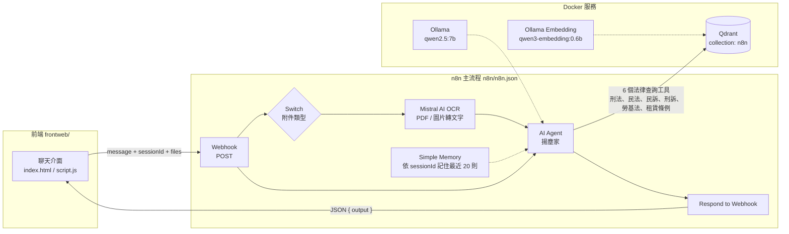
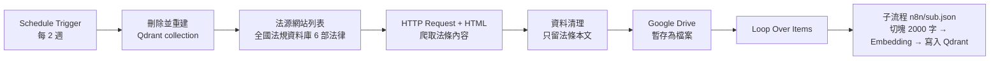
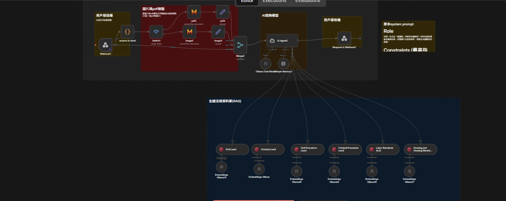
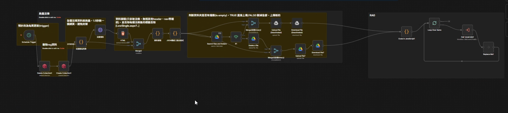

# ⚖️ AI 法律顧問系統（n8n Workflow + RAG）

這是一個基於 Web 的 AI 法律諮詢聊天介面，後端以 n8n 自動化流程串接本地 LLM（Ollama）與向量資料庫（Qdrant），讓使用者用自然語言提問、或上傳 PDF／圖片後，得到「有法條依據、一般民眾也看得懂」的回覆。

> 本專案為小組課程期末專題。

---

## 📌 專案定位

目標不只是「能回答」，而是：

1. 回答前一定先查法條資料庫，避免憑記憶亂答
2. 先用白話解釋，再引述法條原文
3. 能結合使用者上傳的合約、筆錄等文件內容一起分析

小組分工涵蓋：前端聊天介面、n8n workflow 建置（Webhook、RAG、記憶、檔案處理）、法規資料爬取與向量化、Docker 部署整合。

---

## 🏗️ 系統架構



法規資料庫的建置是另一條獨立流程，由排程觸發：



### 工作流總覽（主流程）



### RAG 流程（法條爬取與資料處理）



---

## 🔍 實作對照

此 repository 內可直接對照到的重點：

1. `docker-compose.yml` 啟動 n8n、Ollama（GPU）、Qdrant
2. `frontweb/script.js` 以 Webhook 呼叫 n8n（預設 `localhost:5678`），並送出 `message`、`sessionId` 與附件
3. `n8n/n8n.json`（主流程）包含：
   - Webhook 入口 + Respond to Webhook
   - Switch 依附件類型分流，PDF／圖片交給 Mistral AI 做文字擷取
   - AI Agent + Ollama Chat Model（`qwen2.5:7b`）+ Simple Memory（Memory Buffer Window）
   - 6 個 Qdrant Vector Store 查詢工具 + Ollama Embedding（`qwen3-embedding:0.6b`）
   - 排程爬取全國法規資料庫、清理資料、存到 Google Drive 後送進子流程
4. `n8n/sub.json`（子流程）負責資料分段、向量化與寫入 Qdrant

---

## ⚙️ 技術選型與演進

這一段描述的是專案期間的思考，不代表每一個選項都留在此 repo：

### 1) LLM 路線

- 初期：嘗試本地模型（Ollama）降低成本
- 觀察：在多人同時使用情境下，品質與延遲較不穩定
- 演進：評估雲端模型（例如 Gemini）提升穩定性與輸出品質

### 2) 向量資料庫路線

- 初期：雲端向量庫方案
- 觀察：在課程專題本地測試情境下，外部依賴與延遲管理成本偏高
- 演進：改採本地 Qdrant，降低系統複雜度並提高查詢可控性

### 3) Embedding 路線

- 比較不同 embedding 模型在繁體中文法律語境下的語意貼合度
- 此版本以 Ollama embedding（`qwen3-embedding:0.6b`）為主

---

## 📦 專案結構

```text
.
├─ docker-compose.yml       # n8n + Ollama + Qdrant
├─ .gitignore
├─ main.png                 # 主流程截圖
├─ rag.png                  # RAG 流程截圖
├─ frontweb/
│  ├─ index.html            # 聊天室介面
│  ├─ script.js             # 聊天、檔案上傳、對話記憶 (Session) 邏輯
│  └─ style.css             # 介面樣式
├─ n8n/
│  ├─ n8n.json              # 主流程
│  └─ sub.json              # 子流程（向量化寫入 Qdrant）
└─ testdata/
   └─ README.md             # 測試檔說明（實際測試檔不進 repo）
```

---

## 🚀 快速開始

### 1) 啟動服務

`docker-compose.yml` 中的 `n8n_data` 是外部 volume，第一次啟動前要先建立：

```bash
docker volume create n8n_data
docker compose up -d
```

服務預設埠：

- n8n: `5678`
- Ollama: `11434`
- Qdrant: `6333` (HTTP), `6334` (gRPC)

### 2) 下載模型

```bash
docker exec -it ollama_server ollama pull qwen2.5:7b
docker exec -it ollama_server ollama pull qwen3-embedding:0.6b
```

### 3) 匯入 workflow

在 n8n 匯入：

1. `n8n/sub.json`（子流程，先匯入）
2. `n8n/n8n.json`（主流程）

匯入後要做的設定：

- 主流程的「Call RAG 子流程」節點重新選擇剛匯入的子流程（原本綁的是組員 n8n 裡的 workflow ID）
- 設定 credentials：
  - Ollama：`http://ollama:11434`（同一個 Docker 網路內用服務名稱連線）
  - Qdrant：`http://qdrant:6333`
  - Mistral AI：PDF／圖片文字擷取用，需要 API key
  - Google Drive：法規資料暫存用，資料夾要改成自己的
- 第一次使用前，手動執行一次排程那條流程，把法條寫進 Qdrant

### 4) 開啟前端

直接以瀏覽器開啟 `frontweb/index.html`，輸入法律問題或上傳檔案（PDF／圖片）即可開始諮詢。

---

## 🔗 Webhook 設定

前端透過 `frontweb/script.js` 最上方的 `WEBHOOK_URL` 連到 n8n。請依 n8n 的狀態切換（各位請確認自己的網址）：

### 1. 測試模式 (Test Mode) - 開發用

在 n8n 編輯器中修改流程，並手動點擊「Execute Workflow」時使用：

- **網址**: `http://localhost:5678/webhook-test/c40caa34-56d0-4d64-a083-faa22af6ff99`
- **注意**: 此模式下流程**不會**自動執行，必須在 n8n 編輯器中手動點擊執行。

### 2. 生產模式 (Production Mode) - 正式用

希望聊天室能持續自動運作時使用：

- **網址**: `http://localhost:5678/webhook/c40caa34-56d0-4d64-a083-faa22af6ff99`
- **必要條件**: 必須將 n8n 編輯器右上角的開關設為 **Active（啟用／綠色）**。

```javascript
// 測試用 (需要開著 n8n 編輯器並點擊執行)
// const WEBHOOK_URL = 'http://localhost:5678/webhook-test/c40caa34-56d0-4d64-a083-faa22af6ff99';

// 正式用 (n8n 需設為 Active)
const WEBHOOK_URL = 'http://localhost:5678/webhook/c40caa34-56d0-4d64-a083-faa22af6ff99';
```

---

## 🔧 對話記憶功能 (Conversation Memory)

為了讓 AI 能記住之前的對話內容：

1. **前端**：`script.js` 會自動產生一個 `sessionId`，每次發送訊息時一起送出。
2. **n8n 後端**：主流程使用 **Simple Memory**（Memory Buffer Window）節點，設定如下：
   - **Session ID Type**: Custom Key
   - **Session Key**: `{{ $json.body.sessionId }}`
   - **Context Window Length**: `20`（記住最近 20 則對話）

> **注意**: Simple Memory 存在 n8n 的記憶體中，n8n 重啟後對話紀錄會消失。如果要長期保存，需要改用 Postgres Chat Memory 等資料庫型的記憶節點。

---

## 🤖 AI Agent 角色設定

AI Agent 的 system prompt 設定在 `n8n/n8n.json` 的「AI Agent1」節點中，重點如下：

- **角色**：名為「揚塵家」的法律諮詢好夥伴，把複雜的法律條文轉成一般民眾聽得懂的說明
- **輸出格式**：繁體中文；不使用 Markdown 符號，改用「一、」「1.」「(1)」排版，方便手機閱讀
- **最高指令**：
  1. 回答前**必須**先使用法律查詢工具，嚴禁憑記憶說出法條
  2. 先說白話意思，再引述法條內容
  3. 資料庫找不到時誠實告知，並建議諮詢實體律師
  4. 不要求使用者提供真實姓名、身分證字號、詳細地址等個資
- **回答步驟**：安撫情緒 → 白話說明法律規定 → 引述具體法條 → 給出下一步行動建議

---

## 🧠 專案反思

1. 法律場景重點不只在回答速度，而是「可追溯依據」與「一般民眾可理解的白話說明」
2. 純法條 RAG 有幫助，但若未來擴充到判決書與實務見解，價值會更高
3. 真正上線時，模型選型通常是品質、成本、延遲與維運難度的平衡，而非單點最優

---

## ⚠️ 免責聲明

本系統回覆僅供參考，不構成正式法律意見。重大或高風險案件，仍建議諮詢合格律師。
